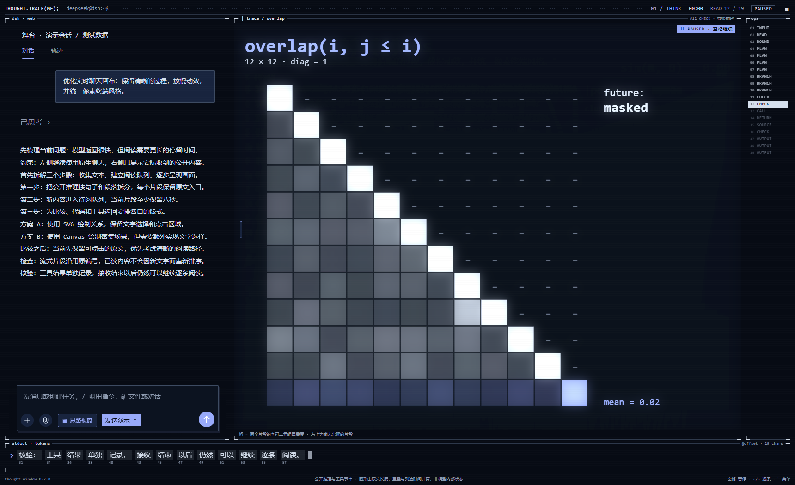

# Thought Window · 思路视窗

DSH Web 的像素终端风对话插件。**左侧使用 DSH 原生聊天**、附件、发送/停止和工具审批；**右侧呈现公开推理与工具事件**。

当前发布版本：**v0.10.1**。安装包见 [Releases](https://github.com/Funkierry/dsh-thought-window/releases/tag/v0.10.1)。



[查看 v0.7.0 动效演示](docs/images/stage-v0.7.0.gif)。这组历史预览采用模拟会话与测试数据，最新版本另有角色导演、回答画布与 21 种图形。

## 功能

- **0.10.1 节奏与开屏修复**：舞台把相邻短句合并为约 160 字的阅读片段，代码围栏保留完整；场景自动切换至少间隔 5 秒，角色动作序列每 6 秒推进，姿势帧播放速度放慢为原来的 2/3。开屏播放标记存入当前标签页的 `sessionStorage`，切换会话、插件热重载或刷新页面不会重复自动播放；仍可从菜单手动重播。

- **0.10 场景跟着思考变**：模型思考（或运行非 shell 工具）时，舞台按正在阅读的片段切换整幅画面，角色暂时退到对话栏头像里；回答时角色回到舞台。新增 6 种画面，共 21 种：分词器（当前句的词块与原文偏移）、Agent 流程图（THINK → PLAN → ACT → OBSERVE，下方为计划清单和每个片段落在哪条泳道）、diff 改写（上一段红、这一段绿）、采样螺旋（当前片段从中心旋出、接着之前的推理，左下是字频）、next_token 占比（关键词出现次数占比，不是模型概率）、红色大字报错。规划、比较、检查、修正、报错等各对应一组画面，普通推理在 8 种之间轮换，相邻两步不重复。手动点 ops 里某一步，显示那一步的画面。
- **结果打在画布上**：回答生成时，角色退到左侧，右侧弹出 `stdout · answer` 面板，把回答逐字打出来（去掉 Markdown 标记，表格按列显示，代码块交给终端）。回答结束后保留在画布上，直到下一轮。
- **开屏动画**：照参考 PV 的开场，约 11 秒，点击或按任意键跳过：`./thought-window --attach` 自检日志与 `#` 画的盾牌 → 模块格子逐个加载（盾牌的点飞进格子）→ 一个像素长成方框，`me = Object()` 逐项填写并拼出当前角色 → `neofetch` 列出插件版本、模型、画面数、动作数、本会话轮次，并滚动显示已观察的字数 → 由数字字符拼成的 3、2、1 → RUN。之后界面各框从中心展开。0.10.1 起，同一标签页会话只自动播放一次；菜单「舞台」里可关闭或重播。所有数值都是真实的。

- **0.9 构图与表演**：角色画面分成互不重叠的三区：顶部标题与 `me.name / me.action` 登记表，中间舞台（角色、道具、灯光，或角色 + 终端），底部 `[ OK ] ...` 日志带逐行打出本轮真实事件（输入、思考、工具、回答、导演）。度量图不再叠在角色后面，只在菜单「舞台 → 度量」里单独显示。
- 角色更丰富：导演为角色画 1–2 帧姿势，舞台按动作节奏逐帧切换（模型给的帧差别太小时，自动生成左倾 / 右倾 / 压扁三帧保底）；每个阶段排 1–3 个动作轮流做；最多 2 个小道具（话筒、音符、键盘……）带自己的浮动 / 弹跳；跳舞、开心等动作打像素舞台灯；思考时角色轮廓由实时推理文字填满，回答时换回像素块。
- 左侧对话栏按参考 PV 重做：顶部为当前角色的像素头像、名字与状态（如 `思考中 · think()`），右侧保留「对话 / 轨迹」切换；圆角深蓝气泡与输入框、无衬线字体；底部一行 `N 轮 · M 步 · 导演 X tok`。
- 导演更稳：模型返回的 JSON 若漏逗号、多或少括号、把字段写进了 actor 里，会先在本地修复；修不好才重调一次。有上一个角色时默认沿用。实测 deepseek-flash 每条消息约 1,500–2,000 token、1.5–3.5 秒。

- **0.8「角色导演」**：每次你发消息，插件额外调用一次 DSH 当前默认模型（关闭推理，实测约 1,100 token、2 秒），让它读懂你的话并返回一份剧本：主角是什么（模型画的像素图，最多 32×32）、思考 / 工具 / 回答 / 完成四个阶段各做什么动作、说什么话、要不要打开终端。舞台全部在画布上用像素演出：角色从地面拼出来，换角色时旧角色的像素飞去拼成新角色；动作有跳舞、跳跃、旋转、点头、摇头、走路、睡觉、爆散重组等 16 种；台词在像素气泡里打出；音符、爱心、星星、雨等效果飘在头顶。
- 例：「你是一个茄子」→ 像素茄子登场；「你会跳舞吗」→ 导演记得上一轮的茄子，茄子开始跳舞；「写一段斐波那契代码」→ 一个像素终端从底部拼出来，逐行打出回答里**真实的代码**（流式输出时跟着增长），角色缩到左边敲键盘。工具运行 shell 命令时终端显示命令与输出。
- 角色动作跟随回合的实时阶段，而不是阅读位置：模型在思考时角色在想，跑工具时在敲键盘，回答时点头，结束时做导演安排的动作。原来的 15 种度量图退到角色后面，作为淡化的背景层。
- 只为实时回合调用导演；同一轮只调用一次，结果和当前角色按会话存在本浏览器，重开对话不会重复花费。打开历史回合使用最后的角色；菜单里可以「重新导演本轮」「换回默认角色」，或关闭导演（默认角色为内置的像素小鲸鱼，不调用模型）。菜单「舞台」一栏可以切回 0.7 的纯度量画面。
- 安全：调用走 DSH 自己的 LLM 服务和默认模型选择，插件不读取 API Key；接口复用 DSH 网页的登录 Cookie 与 Host/Origin 校验，并要求自定义请求头，其他网站无法触发调用。模型返回的剧本逐字段校验（动作白名单、颜色格式、尺寸与长度上限），不会作为代码或 HTML 执行。

- **0.7「舞台」为默认视图**：整页变成一台终端，结构对齐参考 PV：顶栏（`THOUGHT.TRACE(ME);`、阶段 `00 STDIN / 01 THINK / 02 TOOL / 03 OUTPUT`、到达波形、用时、阅读位置、状态）、左侧带角标框的原生聊天（`dsh · web`）、中间一张 Canvas 主图、右侧 `ops` 索引、底部 `stdout · tokens` 词块行和一行署名。标题栏、视图标签、阅读控制、回放时间轴等全部收进 `≡` 菜单（或按 `` ` ``），画面上不再有按钮和说明卡片。
- **画出来，而不是填模板**：每一步由原文现场计算出一张图：字数柱、累计字符曲线、相邻片段的逐字网格（带扫描线）、字符二元组点云（缓慢旋转）、片段重叠下三角阵、输入关键词大字、`[ CHK ]` 日志、工具返回的逐字载荷、并列塔与 `sim`、红笔删除线、代码逐行、符号柱、回答逐字成页、表格逐格，共 15 种。同一类内容连续出现时会在 2 种画法间交替，普通推理在 5 种度量间轮换，相邻两步不重复。
- **生成感与连续性**：图由几千个粒子组成。换图时旧图的粒子飞向新图的位置（大字的像素会变成网格的格子），新增部分从图的基线往上长，多余的下沉消散；标题与数字先乱码再定格。残影、辉光与扫描线参考原片后期。流式增长的同一句只移动变化的部分。
- **底部词块行**：当前句按词切分，词块逐个打出，下方是该词在原文中的字符偏移（不是 token ID）。点击词块行打开完整原文。
- 快捷键：空格 暂停 / 继续，← / → 逐条，End 跳到最新，`` ` `` 菜单，Esc 关闭菜单。输入框、下拉框和时间轴保留自己的按键。点击主图上的点群或格子会跳到对应片段。
- 舞台模式默认隐藏 DSH 左侧工作区栏，菜单里可以「显示 DSH 侧栏」；关闭插件或切到其他视图时恢复。窗口窄于 920 px 或打开成果预览时，自动改为上下排列的紧凑舞台。0.6 的过程仪表、成果 / 运行、自动场景、终端、节点视图都在菜单里，行为不变。

- **0.6「成果 / 运行」**：文件写入、修改、显式交付与 PowerShell / Bash 调用放到同一个工作台，展示原始命令、输出、异常退出码和后台查询状态。来自公开工具记录与 DSH 轮次交付索引，不从回答中猜测文件存在。
- 成果入口直接调用 DSH 的原生文件预览；HTML 可在宿主的隔离预览中交互，其他文件使用宿主对应查看器。只在点击预览时打开文件，工作台不会重跑命令。
- **成果伴随条**：打开本会话的右侧文件预览后，仪表自动收为 118 px 的底部条，保留成果名和最近运行状态。可展开过程或成果记录；关闭预览后恢复正常布局。不移动或重建原生预览 DOM。
- 过程阅读与成果状态相互独立：成果记录及时更新，折叠期间暂停逐条阅读；切换到成果面板后，返回过程视图仍保留阅读位置。

- **0.5 引入「过程仪表」视图**：整体深黑终端配色，固定角标边框、右侧 ops 索引、底部 stdout 原文与分层阅读路径。当前公开内容按句子拆分，代码围栏保留完整；选择片段可追溯来源。
- **接收与阅读分离**：新内容先进入待阅队列，默认每步至少 8 秒；可选 5 / 8 / 12 秒，长文本自动延长到最多 20 秒。支持暂停、上一条、下一条和跳到最新。完成回答不会抢走当前阅读焦点。
- **按内容调整结构**：步骤序列、并列比较、请求/返回、代码、公式、核验记录、修正记录、资料索引、内容寄存器。正在流式增长的同一句保持版式；卡片在换步时用 1.2–1.6 秒位移和淡入衔接，外框与操作栏保持稳定。
- 阅读路径的四层分别对应输入、公开推理、工具与回答；连线仅表示原文先后顺序，数字是片段序号。顶部柱形对应实际片段字数，不生成假分数或模型参数。
- 0.5 采用独立的 v5 外观偏好，当时首次更新默认进入「过程仪表 / 深黑仪表」；0.7 起默认进入「舞台」，原有视图与配色仍可从菜单选择。

- **0.4.1 宿主外观修复**：侧栏、菜单、消息气泡、输入框及代码块跟随插件主题，修复 DSH 深色模式下的纸白/黑色混搭和低对比度文字。关闭插件后恢复宿主原有主题。主图完整保留在右侧，长原文在下方独立滚动；换场景或新一轮对话会重置原文滚动位置。

- **0.4「思路剧场」**：根据当前轮公开推理和工具事件，切换梳理、规划、比较、检索、代码、公式、执行、检查、修正、回答 10 类场景。字符流、管线、分支、检索环、字形标题与纸页图形各有不同构图，下面保留可点击的原文。
- **连续转场**：旧画面退场与新画面入场交叠，用像素载体和焦点方块衔接；按场景使用平移、聚焦、分叉、环绕、管线传递、折叠、回退、汇聚等连续补间。快速切换只保留一个退场层，直接接到最新内容。
- 7 套配色：深黑仪表、纸白档案、深海终端、琥珀显像管、荧光绿屏、紫晶像素、工程蓝图。过程仪表默认两侧统一为深黑；经典自动场景在自动配色时右侧跟随场景、聊天保持纸白。手动配色时两侧统一。
- 右上角「⚙」展开配色、动效强度和本地保存设置；默认收起，给内容更多空间。动效可选「丰富 / 轻柔」，也可关闭；系统减少动态效果会同时停用 CSS 和 JS 动画。
- 场景菜单可以手动固定模板，内容仍随新消息更新；「终端」「节点」视图保留。
- 终端视图保留角标分区框、事件索引、虚线圆点列表、事件缓存格和文本长度曲线。风格参考 [world-execute-me-dsh-pv](https://github.com/MisakaZentai/world-execute-me-dsh-pv)，见 `NOTICE.md`。
- 实时展示用户输入、公开推理分段、工具调用与结果、回答、错误和重试。
- 点击节点查看对应原文。流式输出完成后沿用节点 ID；不会重复插入同一条消息。
- 时间轴回放、0.5× / 1× / 2× 播放、JSON 导入与导出。
- 可选本地回放保存，默认关闭；支持一键清除插件回放。
- 宽屏左聊天、右画布；拖动分隔线调整比例，双击恢复默认，聚焦分隔线后也可用左右箭头或 Home 键调整。窄窗口聊天在上、画布在下。输入框旁的「▦ 思路视窗」可开关。

## 安装到本机 DSH Web

先确保已经运行过 DSH Web，存在 `~/.dsh/profiles/web/package.json`。

在本插件目录打开 PowerShell：

```powershell
powershell -ExecutionPolicy Bypass -File .\scripts\install.ps1
```

脚本仅安装本包、为 profile 添加 bundle 和本地依赖，并备份原 `package.json`；不会重启进程或修改已有对话。安装后正常重启 DSH Web，刷新浏览器。请保留本源码目录，后续包管理器操作可能使用该本地依赖。

自定义目录：

```powershell
.\scripts\install.ps1 -DshHome 'D:\my-dsh' -Profile web
```

也可通过 DSH 包管理命令安装交付的 tgz：

```powershell
dsh plugin --profile web add '完整路径\dsh-thought-window-0.10.1.tgz'
```

若该版本不会自动启用新 bundle，在 profile 的 `dsh.profile.bundles` 列表末尾添加 `dsh-thought-window`。不要覆盖原列表。

## 关闭 / 卸载

临时关闭：点击右侧标题栏 ×，或者输入框旁的插件按钮，立即恢复原聊天布局。

禁用插件：

```powershell
powershell -ExecutionPolicy Bypass -File .\scripts\install.ps1 -Uninstall
```

禁用脚本只移除本包的 bundle 与依赖记录，保留安装文件以便恢复；不会覆盖其他插件配置。重启 DSH Web 后生效。浏览器中的回放可提前通过插件的「清除」按钮删除。

## 数据含义与范围

这是一份**可观察事件的可视化**。只读取 DSH `useChat` / `useSession` 提供的公开推理、消息、工具调用和状态；不读取系统提示词、私有模型内部状态或附件二进制内容。

舞台上的每个数和每个图形都来自 `src/stage-data.cjs` 对公开原文的计算：片段与词的字符数、插件观察到的到达时间（顶栏波形与累计曲线）、字符二元组的 Jaccard 重叠、固定种子的哈希投影（点云位置，不是语义向量）、工具参数与返回的字符数。图下方一行说明当前图的数据来源。`CHK` 只表示原文里有核验描述，`RET` 只表示调用已返回，都不代表通过。舞台不显示模型参数、注意力、token ID 或置信度。

「比较、检查、修正」是文本规则产生的标签，卡片内容是原文片段，不是额外模型生成的总结。虚线是事件顺序，实线子工具关系来自 `parentCallId`；不表示内部因果、置信度或注意力权重。模型没有返回公开推理时，仍展示消息和工具事件，并明确提示。

过程仪表只细分当前已加载一轮的内容，最多保留 240 个阅读片段。标签来自文本规则，可能误分；没有公开推理时会明确说明，并只展示实际输入、工具记录与回答。初次查看历史时按宿主的来源顺序排队；实时到达的工具结果追加到已观察队列。已记录时间轴的回放仍按快照定位，和逐条阅读是两种不同模式。

经典「自动场景」采用中英文关键词与事件类型规则，可能误分，可用场景菜单纠正。普通场景需要连续约 650 ms 的候选内容，并保持当前版式至少 1.4 s；工具、错误、回答事件使用较短的确认时间。回放拖动和新一轮输入立即切换。没有关键词的同一段后续文字会延续已有场景，减少流式分段造成的跳动。

模板内容均来自当前轮已观察到的原文：比较卡片优先使用明确的「方案 A / B」标题；没有标题时标为比较片段。检索雷达只是动效，不表示检索覆盖率。检查清单不会自动判定通过；工具运行灯不表示完成百分比。代码会重新拼接同一个公开推理块中的流式片段，最多显示 28 行；公式按原文显示，不额外求值。完整原文仍可在左侧查看。

0.4 参考 PV 的方法是“内容事件 → 构图 → 承接物 → 连续运动”。歌曲时间轴改为当前会话事件：同一场景里持续更新内容，语义类型变化才切镜头。转场像素是装饰，图形中的线表示阅读顺序或并列关系；不表示模型内部参数、注意力或额外推理。画面不需要背景视频、音乐或生成图片。左侧原生消息始终可操作；退场画面禁用鼠标和键盘交互。拖动回放时间轴即时定位，播放回放时仍有连续转场。

终端视图中的圆点大小和曲线对应**已显示原文的字符数**，下方缓存条一格代表一个事件。事件索引 `IN / TH / IO / OUT / ERR` 分别对应输入、推理/重试、工具、回答、错误。这里不展示虚构的参数矩阵、分词 ID 或模型内部状态。视频工程的逐帧效果已改写为浏览器实时绘制，不需要 Python、视频渲染器或背景视频。

当前视图最多 160 个节点；每个推理块保留最近 40 段；单节点原文超过 12,000 字符会注明截断。更早和更长的内容请在左侧 DSH 原对话查看。这里只读取 DSH 当前已加载的历史窗口，不会额外拉取整个归档。

回放记录的是插件开启期间观察到的状态，约每 900 ms 一帧，结束状态即时记录；首次打开旧对话只得到当时的快照，不能还原此前逐字生成过程。内存回放最多 90 帧并按约 4 MB 文本预算裁剪；可选 IndexedDB 保存最多 10 个会话。关闭「本地保存」会停止后续保存，已有记录通过「清除」删除。清除只影响插件存储。导出文件包含画布原文，导入只用于查看，不执行内容。

插件不执行命令。除角色导演外不发起模型请求：导演只在实时回合、每条消息调用一次，可在菜单关闭。点击成果预览时委托 DSH 打开目标文件；文件读取与 HTML 的隔离方式由原生查看器负责。

工作台当前最多保留本轮 40 个文件与 40 次命令调用；每次输出保留末尾 8,000 字符。Shell 创建的文件需要 DSH 的 `present` 交付记录才会列入成果，普通输出中的文件名不作为创建证据。非零退出码、超时和信号终止分别来自工具返回标记；“调用已返回”不等于程序验证通过。后台状态显示最近一次 `job_output` 记录，不额外轮询进程。回放包含这些记录，但不允许把回放路径直接打开到当前会话。

## 兼容与实现

以本机 DSH Web `0.1.5-rc.2` 的客户端契约开发。通过 `conversation.input.left` 插槽取得会话 hooks，使用宿主 React / ReactDOM，不重复打包 React。宿主半侧（`src/host.mjs` → `lib/index.js`）只注册一个导演路由 `/thought-window-director`，依赖 `webServer`、`connection`、`llm`、`agentDefaultModel` 四个宿主服务。

该版本未提供外层双栏布局工厂，因此布局采用一个独立 DOM 适配层：定位含 `[data-conversation-scroll]` 的 `[data-phase]` 会话根，在其中添加自己的 React portal 和 CSS 类。没有移动、替换或解析原聊天 DOM。关闭或卸载时清理自有节点、类、观察器及样式。后续 DSH 更新如果改变这两个结构标记，需要更新 `src/client.cjs`；找不到标记时显示兼容提示并保留原聊天。

## 开发

Node.js 20+，无须下载构建依赖：

```powershell
npm run build
npm test
npm pack
```

- `src/stage.cjs` / `src/stage.css`：舞台外壳、顶栏、ops、词块行、菜单与快捷键；全屏布局与紧凑布局。
- `src/stage-engine.cjs`：Canvas 粒子引擎：跨图延续、基线生长、文字解码、残影与辉光；减少动态效果时直接画终态。
- `src/stage-figures.cjs`：21 种图形的纯函数布局（目标点、文字、扫描线 / 光标），随画布尺寸缩放。
- `src/stage-data.cjs`：分词与偏移、关键词、二元组重叠、哈希投影、阶段与选图规则。
- `src/process-data.cjs`：保留来源偏移的细分、稳定阅读队列、按字数确定停留时间。
- `src/process.cjs` / `src/process.css`：过程仪表、原文卡片、工具双栏、分层路径与连续焦点。
- `src/work-data.cjs`：本轮文件与运行投影、退出状态、后台记录、成果回放校验。
- `src/workbench.cjs` / `workbench.css`：成果工作台、只读日志及预览伴随条。
- `src/host-bridge.cjs`：DSH 公开 Sidebar 与 Session API 适配；点击后打开 session-scoped 文件地址。
- `src/core.cjs`：事件投影、稳定 ID、文本分段、回放校验和边界。
- `src/view.cjs` / `style.css`：动态画布、主题、原文与回放。
- `src/scenes.cjs`：场景分类、切换缓冲、模板数据提取。
- `src/adaptive.cjs` / `adaptive.css`：10 类经典模板及场景动效。
- `src/figure.cjs` / `cinema.css`：字符图形、场景构图及新的左右布局。
- `src/transition.cjs` / `choreography.cjs`：连续转场、像素轨迹、退场清理和分栏边界。
- `src/terminal.cjs`：终端索引、圆点列表和事件仪表。
- `src/client.cjs`：DSH 插槽和布局适配。
- `src/host-theme.cjs` / `host.css`：原生 DSH 的完整颜色变量、侧栏与输入区样式，以及可撤销的页面主题。
- `src/storage.cjs`：插件专有 IndexedDB 存储。
- `scripts/build.mjs`：生成 DSH `__ModuleLoader__` 工厂，外部模块交给宿主加载。

构建产物为 `lib/client.js` 和 `lib/index.js`，可直接安装。

## 本次验证范围

0.10.1 构建成功，54 项单元测试通过，包括相邻短句合并、代码围栏完整、流式分段稳定与开屏重复挂载保护。此次发布的客户端和宿主构建产物与本机安装版逐字节一致。

0.10.0 共 52 项单元测试（新增开屏步骤：时间顺序、全部在画布内、显示真实的版本/会话/模型/角色与导演花费提示；6 种新画面纳入通用的不越界、id 唯一、从下方生长检查）。

0.9.0 共 51 项单元测试（新增：姿势帧对齐与上限、动作序列、道具、分区不重叠、帧切换原地替换、思考时文字填充、JSON 修复四种情形）。真实接口连续三句（茄子 → 跳舞 → 写代码）均首次成功并沿用角色。

0.8.0 新增 7 项导演与角色测试（剧本解析与校验、像素图清洗、请求封装、实时阶段、终端取真实代码、角色画面不越界并从地面生长），共 46 项通过；模拟导演接口的三轮对话（茄子 → 跳舞 → 写代码）每轮只调用一次；本机 DSH 上真实调用导演一次，返回可用的像素茄子剧本，未登录请求返回 401。

0.7.0 通过 39 项单元测试（新增 7 项：词块偏移、关键词、重叠阵、投影确定性、选图规则、15 种图形不越界且 id 唯一并从下方生长、流式增长保留已画部分）。在本机 DSH 0.1.5 真实 CSS 与 DOM 快照上检查了：舞台默认开启并隐藏侧栏，聊天框可正常点击输入，空格在输入框里不会暂停阅读，快捷键与菜单，六种视图切换，原文面板，1280 / 1024 / 700 / 420 px 宽度，减少动态效果，关闭后恢复侧栏与布局。一段模拟的实时流式回合中，阅读自动推进，一轮内出现 7 种以上图形，无页面错误。0.6 的过程仪表、成果工作台（含预览伴随条）和七套配色回归检查在 0.7 下全部通过。

0.6.0 通过 32 项事件投影、回放、场景、几何和细分队列单元测试。Chrome 检查验证了默认 8 秒停留、突发消息不跳步、来源追溯、工具请求与返回、七种内容状态、减少动态效果、窄窗口和关闭清理。

外观回归加载本机 DSH 0.1.5 的真实 CSS、主题变量、侧栏与输入区 DOM 快照，验证七套配色、十类经典场景、长原文独立滚动、分栏及主题恢复。气泡与输入区文字对比度在七套主题下均达到 4.5:1。经典视图的连续转场与快速中断检查也通过。

成果工作台还验证了文件去重、失败退出、独立交付数据更新、显式打开预览、回放路径隔离、预览状态保留及 118 px 收起布局；预览测试使用可交互 HTML 夹具和按公开契约实现的宿主服务替身。

这些交互检查使用测试消息与测试接入层，不能代替真实账号的发送、审批端到端测试。隔离的 DSH 测试 home 已验证原生页面启动和插件发现；本版数据接入契约未变。

交付预览使用模拟事件；未调用用户的真实模型，也未向真实会话发送测试消息。新安装需正常重启 DSH Web；已启用插件的更新可由宿主热加载发现。更新后浏览器强制刷新即可加载。
