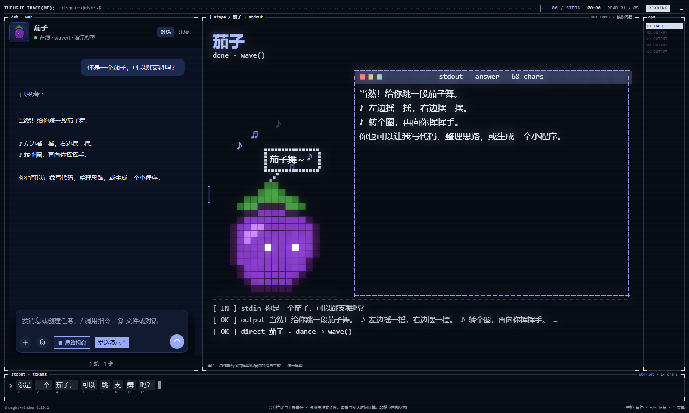
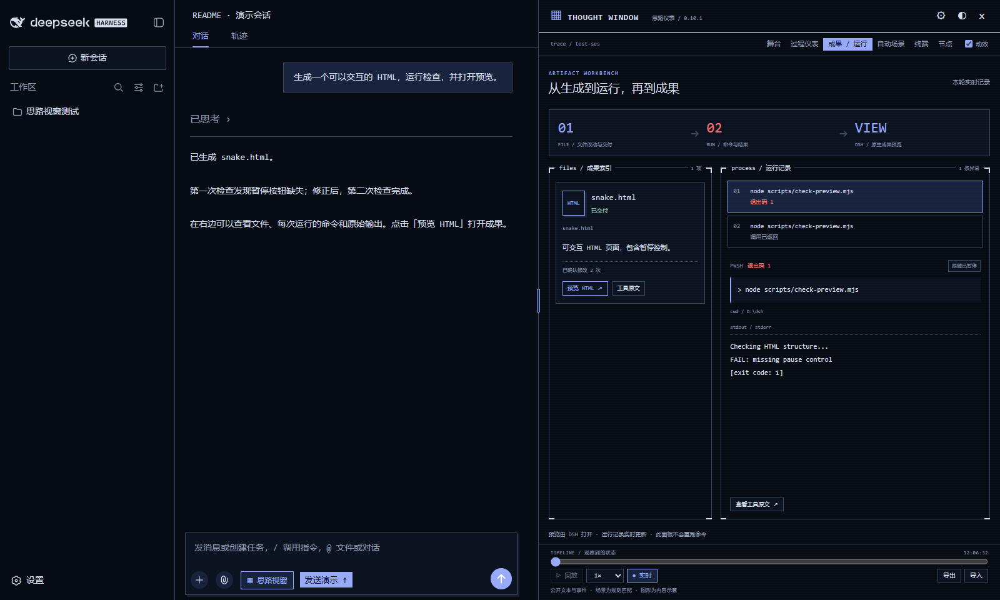
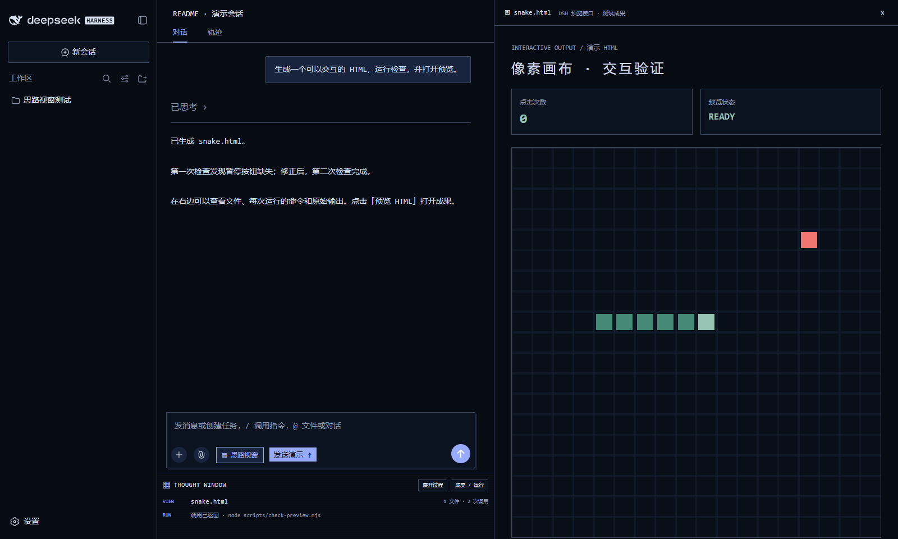
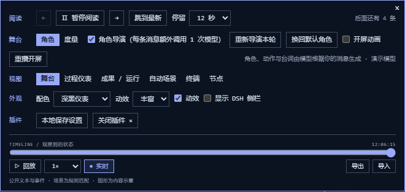

# Thought Window · 思路视窗

**把 DeepSeek Harness 的聊天界面，变成一座会动的像素舞台。**

左边照常聊天、传文件、批准工具操作；右边跟着对话展示思考片段、像素角色、代码和运行结果。所有画面都由代码实时绘制。

**当前版本：v0.10.1** · [下载安装包](https://github.com/Funkierry/dsh-thought-window/releases/latest) · [DeepSeek Harness](https://github.com/deepseek-ai/deepseek-harness) · [技术说明](docs/technical-notes.md)



*本文配图使用 v0.10.1、模拟对话和模拟角色剧本生成，用于展示界面，不含真实聊天记录。实际角色由你使用的模型生成。*

## 它能做什么？

### 让思考过程更好读

收到公开思考内容后，插件会把它整理成可以慢慢看的片段，再根据内容切换到规划、比较、检查、代码等画面，共有 **21 种图形**。

内容接收和画面播放分开：模型回复得快，你也可以暂停、逐条看，或者直接跳到最新。v0.10.1 合并了细碎短句，并放慢场景切换。


这些画面来自模型已经返回的文字和工具记录；它们帮助阅读，不代表模型内部的神经网络、注意力或置信度。模型没有返回公开思考时，就展示实际收到的消息和工具事件。

### 聊天时，像素角色也会回应

可以试着依次发送：

> 你是一个茄子。
>
> 你会跳舞吗？
>
> 帮我写一段斐波那契数列代码。

开启「角色导演」后，模型会为对话安排角色、动作和台词：茄子可以跳舞、挥手，也可以在写代码时敲键盘。回答会出现在右侧画布中，代码则进入像素终端。


**角色导演默认开启，会额外消耗模型 token。** 正常每轮调用一次 DSH 当前默认模型；剧本解析失败时可能再重试一次。可以在右上角菜单中关闭，关闭后仍可使用默认小鲸鱼和思考可视化。

### 写文件、跑程序，也能一起看

在菜单中切到 **「成果 / 运行」**，就能看到本轮生成或修改的文件、执行过的命令，以及每次运行的原始输出。运行出错时，也会保留失败记录，方便对照修复前后。



点击文件上的预览按钮，会打开 DSH 自带的查看器。HTML 可以直接交互；这时过程面板自动缩成底部小条，给聊天和成果腾出空间。展开、收起过程面板不会重新加载预览中的页面。



*图中的 HTML 是交互测试页面。实际显示什么，取决于 DSH 生成的文件。运行命令仍由 DSH 负责，插件负责展示记录。*

## 安装

需要先安装并运行过 **DeepSeek Harness Web**，确认原本的聊天功能可以正常使用。本项目目前按 DSH Web **0.1.5-rc.2** 开发和验证。

1. 打开 [最新版本下载页](https://github.com/Funkierry/dsh-thought-window/releases/latest)，下载 `dsh-thought-window-0.10.1.tgz`。
2. 在 PowerShell 中执行下面的命令，把文件路径换成你的下载位置：

   ```powershell
   dsh plugin --profile web add 'C:\你的下载目录\dsh-thought-window-0.10.1.tgz'
   ```

3. 重新启动 DSH Web，再刷新浏览器。进入对话后，点击输入框旁的 **「▦ 思路视窗」** 即可开关插件。

从 v0.7.0 升级时也请重启 DSH Web，因为新版增加了角色导演服务。

<details>
<summary>想从源码安装，或使用自定义 DSH 目录？</summary>

下载并解压源码 ZIP，在包含 `package.json` 的插件目录中打开 PowerShell，然后执行：

```powershell
powershell -ExecutionPolicy Bypass -File .\scripts\install.ps1
```

使用自定义目录时：

```powershell
.\scripts\install.ps1 -DshHome 'D:\my-dsh' -Profile web
```

安装脚本会备份原来的 profile 配置，再添加插件。请保留源码目录，后续包管理操作可能用到这个本地依赖。安装完成后重启 DSH Web。

</details>

## 常用设置都在这里

点击舞台右上角的 **`≡`** 打开菜单。



| 你想做什么 | 在哪里操作 |
| --- | --- |
| 画面慢一点 | 「阅读 → 停留」选择 **12 秒**；也可以暂停后手动逐条看 |
| 动效轻一点 | 「外观 → 动效」选择「轻柔」，或取消勾选「动效」 |
| 不想看开屏 | 取消勾选「舞台 → 开屏动画」 |
| 不想额外调用模型 | 取消勾选「舞台 → 角色导演」 |
| 看文件、命令和输出 | 「视图 → 成果 / 运行」 |
| 切换界面风格 | 「外观 → 配色」，可选深黑、纸白、琥珀等 7 套配色 |
| 找回左侧工作区列表 | 勾选「显示 DSH 侧栏」 |
| 看回放 | 使用菜单下方的时间轴；也支持导出、导入 |

常用快捷键：**空格**暂停或继续，**← / →**逐条切换，**End**跳到最新，键盘左上角的**反引号键**打开菜单。输入框打字时会保留正常的输入操作。

## 常见问题

**开屏为什么有时不播放？**

v0.10.1 在同一标签页会话中只自动播放一次，避免切换对话或刷新时反复打断你。想再看一次，可以点菜单里的「重播开屏」。

**角色没有变化，或提示导演接口不可用？**

先确认已经重启 DSH Web，并配置了可用的默认模型，再检查「角色导演」是否开启。已经结束的历史对话不会自动重新生成角色，可以手动点击「重新导演本轮」。

**生成的文件为什么没有出现在成果列表？**

插件根据文件写入、修改和明确交付记录来列出成果。通过 shell 创建的文件，需要 DSH 再明确交付；仅在回答里提到一个文件名，不会自动加入列表。

**会把对话传到别的地方吗？**

可视化在浏览器本地完成。开启角色导演时，会通过 DSH 当前配置的模型服务发送本轮消息和少量上下文，用于生成角色剧本；插件不另设分析服务器。可选的回放保存默认关闭，导出的回放文件包含对话原文。

**怎么关闭？**

点输入框旁的「思路视窗」，或在菜单中选择「关闭插件」，即可恢复原来的聊天布局。

<details>
<summary>彻底禁用插件</summary>

在源码目录中执行，然后重启 DSH Web：

```powershell
powershell -ExecutionPolicy Bypass -File .\scripts\install.ps1 -Uninstall
```

这会移除插件的启用和依赖记录，保留安装文件以便恢复。浏览器内保存的回放可提前在菜单「本地保存设置」中清除。

</details>

## 开发与参考

需要 Node.js 20+。在仓库根目录运行：

```sh
npm run build
npm test
npm pack
```

v0.10.1 已通过 **54 项单元测试**。数据来源、实现方式与交互验证范围见 [技术说明](docs/technical-notes.md)，各版变化见 [发布记录](https://github.com/Funkierry/dsh-thought-window/releases)。

视觉风格参考 [MisakaZentai/world-execute-me-dsh-pv](https://github.com/MisakaZentai/world-execute-me-dsh-pv)，将其中的终端构图和连续动效思路用于实时对话。详细署名见 [NOTICE.md](NOTICE.md)。代码使用 [MIT 许可证](LICENSE)。
