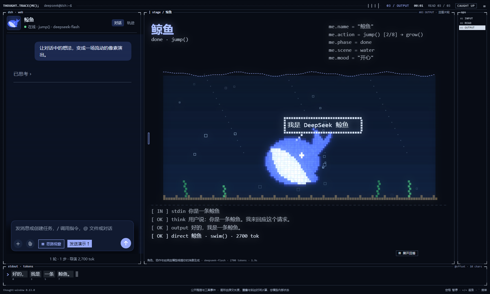
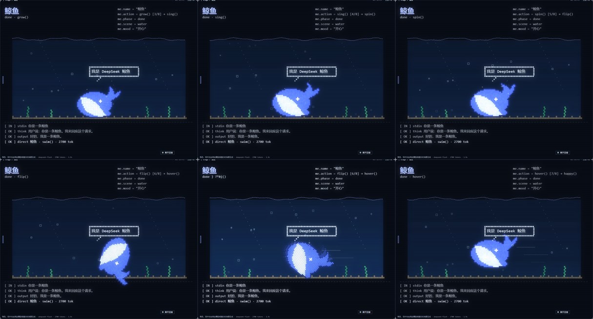
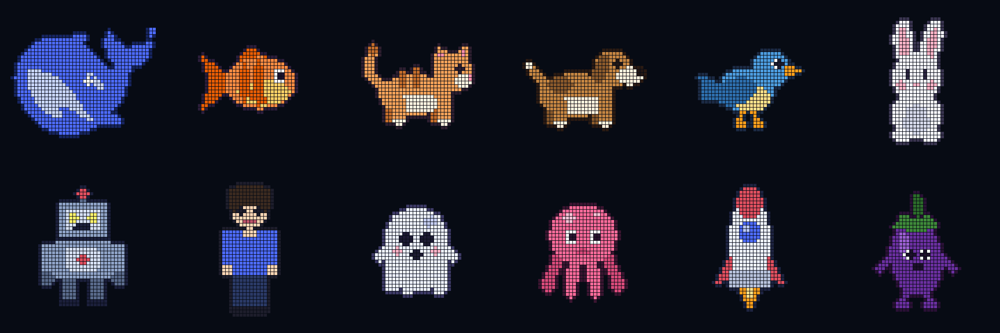
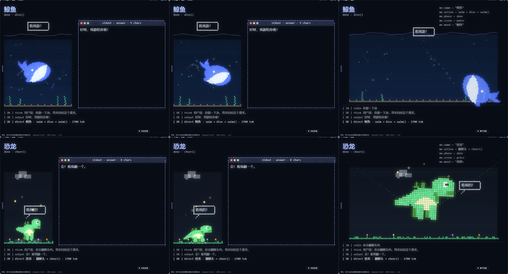
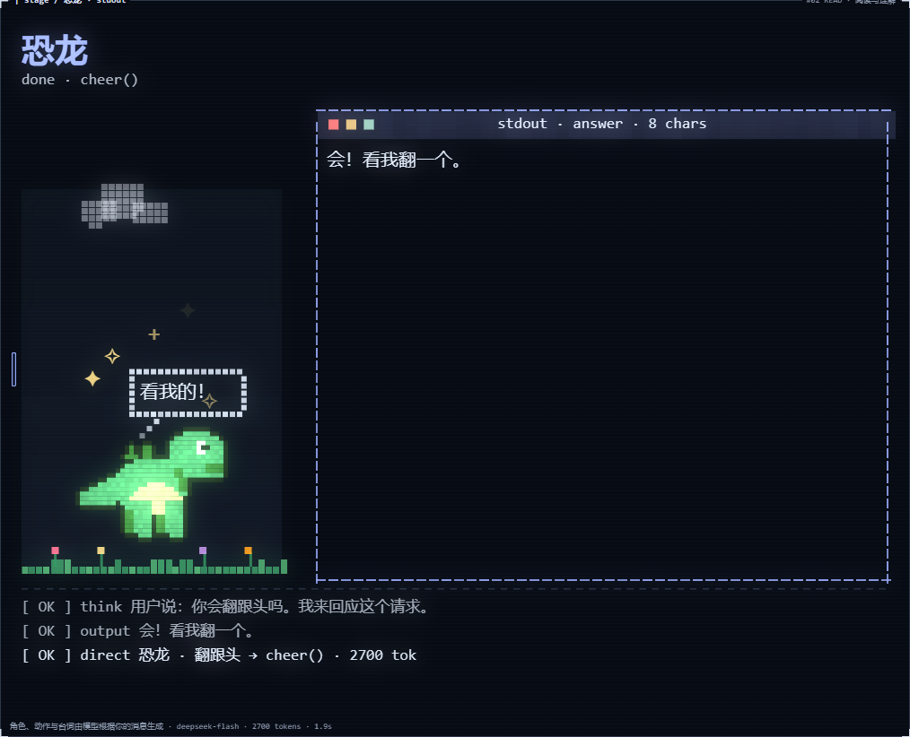
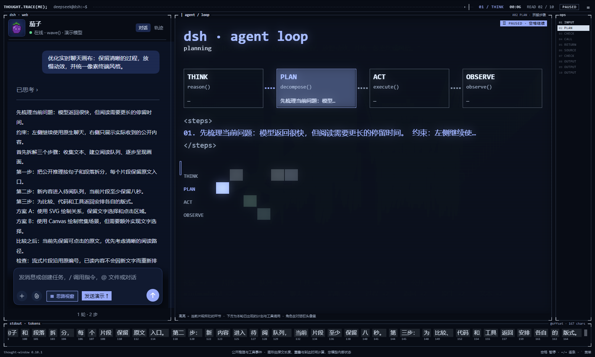
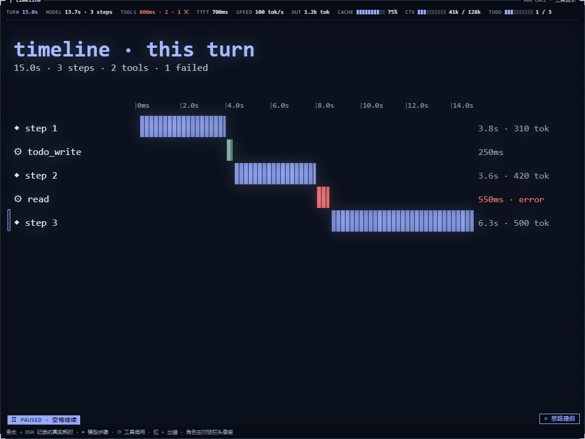
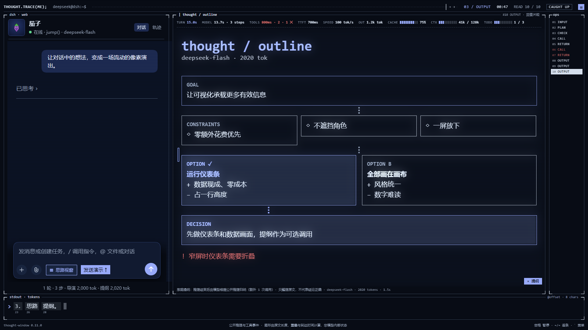
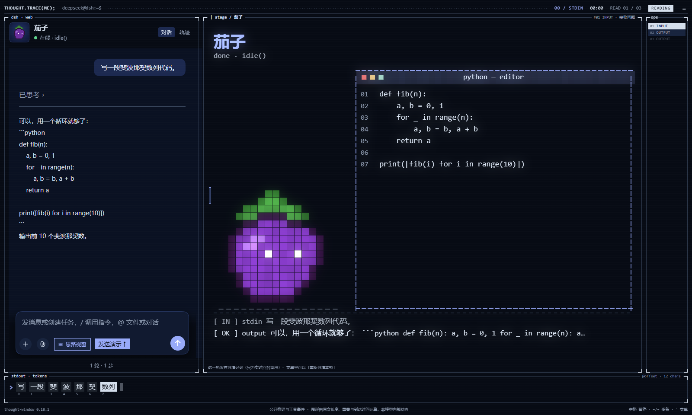

# 🐋 Thought Window · 思路视窗

**让 DeepSeek 一边想，一边在像素舞台上演给你看。**

你在左边照常聊天；右边的舞台上，一条像素小鲸鱼会读懂你的话：你让它游泳，它就在水里游起来；你让它变成恐龙，它就请模型现画一只恐龙，再一格一格把自己拼成恐龙。模型思考时，舞台会把思路画成图；回答写完，它再演一场秀给你看。

**当前版本 v0.14.4** · [下载安装包](https://github.com/Funkierry/dsh-thought-window/releases/latest) · [DeepSeek Harness](https://github.com/deepseek-ai/deepseek-harness) · [技术说明](docs/technical-notes.md)



*本页配图来自插件在模拟对话中的实际画面，不含真实聊天记录。真实使用时，角色、台词和动作由你的模型现场决定。*

---

## 🎬 先看一场演出

打开思路视窗，依次发送下面几句，看看舞台上会发生什么：

| 你说 | 舞台上 |
| --- | --- |
| 你好 | 默认演员 **DeepSeek 小鲸鱼** 登场：鲸鱼的轮廓来自 DeepSeek 的标志 |
| 给我讲讲猫 | 鲸鱼**不会**自己变成猫，只用动作和场景回应；它只听你明确的变身指令 |
| 你是一条鱼 | 鲸鱼散成像素，再拼成一条金鱼；舞台沉入水下，波纹、气泡、水草都出来了 |
| 你是一条鲸鱼 | 变回 DeepSeek 鲸鱼 |
| 你游一下泳 | 鲸鱼在水里来回游，尾巴拍水，身后拖出一串气泡，偶尔跃出水面再扎回去 |
| 你是一只恐龙 | 没有现成造型，模型现场画一只：画布上先出现蓝图框和扫描线，画好后像素重组成恐龙 |
| 你会翻跟头吗 | 内置动作里没有翻跟头，导演就用关键帧现编一个：下蹲、起跳、空翻、落地 |
| 帮我写个排序算法 | 角色旁边弹出像素终端，代码一行一行敲出来 |

每句话结束后，角色还会接着演一整场 **8 个动作的秀**，每 4 秒换一个，不连续重复。画布右上角会显示演到第几个、下一个是什么：

```
me.name   = "鲸鱼"
me.action = flip()  [6/8] → hover()
me.scene  = water
```



---

## ✨ 舞台上有什么

### 🐋 一位听得懂人话的演员

- **默认是 DeepSeek 鲸鱼**，不会擅自换角色。只有你说「你是…」「变成…」「扮演…」「换个形象」时才换；说「变回鲸鱼」，或在菜单里点「换回默认角色」就能回来。
- **12 位常驻演员**，都可以按你说的换颜色，比如「金鱼」「黑猫」：

  

- **想要别的？现场画。** 熊猫、恐龙、独角兽……插件会请模型画一张由身体、头、四肢、尾巴组成的「部件图」，再转成像素。每个部件都能动，所以画出来的角色也会摆尾、挥手、迈腿。
- **30 个动作，过程完整。** 跳跃先下蹲、再起跳、落地时压扁回弹；舞蹈有八拍编排：左移、右移、转身、跳起、定格；游泳、飞、跑、潜水会在舞台里移动，并转向前进方向。两个动作之间平滑过渡，不会瞬移。
- **自编动作。** 内置动作没有的（翻跟头、打太极、跳绳），导演会用关键帧和关节角度现编一个。
- **8 种场景**：水下、天空、太空、夜晚、草地、雪地、城市、舞台，按动作和话题自动切换。
- **跟随特效**：游泳拖出气泡，飞行带起风线，落地扬起尘土，跳舞洒出星光。

回答写完约 8 秒后，回答窗口会自动收起，角色平滑走到舞台中央，用整个舞台表演。回答原文一直在左边聊天里；想再看，点画布右下角的「▤ 展开回答」。





### 🧠 想法被画成图

右侧现在默认开启**多界面轮播，每 3 秒换一页**：文本拆解、字数节奏、关键词雷达、步骤方格、片段关系等界面依次出现；有工具、文件或运行记录时，再加入对应页面。同一段内容可以从不同角度看，不用等到读下一段才换画面。

模型的公开思考仍按较长的片段慢慢阅读，阅读速度和界面轮播互不影响。一共 **29 种画面**，包括 Agent 循环、规划格、比较塔、检查日志、代码、公式，以及关键词雷达、词 × 步骤热力图、词星图。像素从底部生长出来，上一张图会变形成下一张，不是翻页式地换模板。

模型回得再快也不用急：可以暂停、逐条看，或者直接跳到最新。



> 这些画面都是对模型**已经输出的文字和工具记录**的计算和排版，用来帮你阅读，并不代表模型内部的神经元、注意力或置信度。

### 📊 一眼看清这一轮花了多少

画布顶端有一条常驻的**运行仪表**：本轮用时、模型和工具耗时、首个 token 等待、生成速度、输出 token、缓存命中率、上下文占用、待办进度。数字全部来自 DSH 自己的记录，没有记录的项就不显示，绝不拿估算值凑数。

思考过程中还会穿插几种**数据画面**：耗时时间线（出错的步骤标红）、待办清单、改动的文件、上下文与 token 用量。



推理结束时，还能顺手要一张**思路提纲**：目标、约束、考虑过的方案（选中的会高亮）、结论和遗留风险，连成一张流程图。



### 🛠 写代码、跑程序，一起看

- 写代码时，角色旁边弹出像素终端，代码实时敲出来。
- 菜单切到「成果 / 运行」，可以看到本轮生成和修改的文件、执行过的命令和原始输出，失败记录也会保留。
- HTML 文件可以直接用 DSH 自带的查看器打开交互，这时思路视窗会缩成底部的小状态条，给聊天和预览腾出空间。



---

## 📦 装上它

需要先装好并运行过 **DeepSeek Harness Web**（按 DSH Web 0.1.5-rc.2 开发和验证）。

1. 从[发布页](https://github.com/Funkierry/dsh-thought-window/releases/latest)下载 `dsh-thought-window-0.14.4.tgz`。
2. 在 PowerShell 里执行（把路径换成你的下载位置）：

   ```powershell
   dsh plugin --profile web add 'C:\你的下载目录\dsh-thought-window-0.14.4.tgz'
   ```

3. **重启 DSH Web**，刷新浏览器，点输入框旁的 **「▦ 思路视窗」**。舞台开张。

<details>
<summary>从源码安装 / 自定义 DSH 目录</summary>

在解压后的插件目录（含 `package.json`）中执行：

```powershell
powershell -ExecutionPolicy Bypass -File .\scripts\install.ps1
```

自定义目录：

```powershell
.\scripts\install.ps1 -DshHome 'D:\my-dsh' -Profile web
```

脚本会先备份 profile 配置再添加插件。请保留源码目录，装好后重启 DSH Web。

</details>

---

## 🎛 遥控器

舞台右上角的 **`≡`** 是菜单（也可以按键盘左上角的反引号键）。

| 想要 | 怎么做 |
| --- | --- |
| 暂停或手动换画面 | 右侧画布上方点「暂停」、‹ / ›，或从下拉框选一页 |
| 调整轮播速度 | 菜单「轮播 → 每页」选 3 / 5 / 8 秒；取消「多界面依次切换」可恢复按内容换画面 |
| 看慢一点 | 「阅读 → 停留」选 12 秒；或者按空格暂停，用 ← / → 逐条看 |
| 动效温和些 | 「外观 → 动效」选「轻柔」，或关掉「动效」 |
| 回答写完后不收起 | 取消「舞台 → 回答完成后收起回答窗口」 |
| 换回小鲸鱼 | 说「变回鲸鱼」，或点「舞台 → 换回默认角色」 |
| 一个 token 都不想多花 | 关掉「角色导演」和「思路提纲」，可视化照常工作 |
| 再看一次思路提纲 | 画布右下角「◇ 思路提纲」 |
| 换个配色 | 「外观 → 配色」，有深黑、纸白、琥珀等 7 套 |
| 找回 DSH 左侧栏 | 勾选「显示 DSH 侧栏」 |
| 看回放 | 菜单底部的时间轴，支持导出和导入 |

快捷键：**空格**暂停或继续，**← / →** 逐条切换，**End** 跳到最新。在输入框里打字时，这些按键照常输入文字。

---

## 💰 会多花多少 token？

可视化、运行仪表和数据画面都在浏览器本地计算，**不花 token**。下面三项会调用 DSH 当前的默认模型，都可以在菜单里关掉：

| 功能 | 什么时候调用 | 大约花费（实测） |
| --- | --- | --- |
| 角色导演 | 每条消息 1 次 | 约 2,000 token，1–3 秒 |
| 现场作画 | 只在要变成没有现成造型的角色时 | 4,000–16,000 token，10–60 秒 |
| 思路提纲 | 每轮推理结束时 1 次 | 约 500–2,000 token |

---

## ❓ 常见问题

**角色没反应，或提示导演接口不可用？**
先确认装完插件后重启过 DSH Web，并且配置了可用的默认模型，再看「角色导演」有没有打开。已经结束的历史对话不会自动导演，可以手动点「重新导演本轮」。

**为什么它不肯变身？**
这是故意的：默认就是 DeepSeek 鲸鱼，只有明确的变身指令（「你是…」「变成…」「扮演…」）才换。「你是谁」「你是不是机器人」这种提问不算。

**开屏动画怎么不播了？**
开启「开屏动画」后，每次打开或刷新网页都会自动播放一次。切换对话、切换可视化页面和插件热更新不会重复播放。想随时再看，点菜单里的「重播开屏」；播放中可点击或按任意键跳过。系统开启「减少动态效果」时会跳过自动开屏。

**我的对话会被发到别处吗？**
不会另外发到别的地方。可视化都在浏览器本地完成。角色导演、作画和思路提纲只通过 DSH 自己配置的模型服务发送必要内容：本轮消息、一句角色描述，或公开推理（最多约 9,000 字）。插件没有自己的服务器，也不读你的 API key。回放默认不保存；导出的回放文件会包含对话原文。

**生成的文件没出现在成果列表？**
成果列表依据文件写入、修改和明确交付的记录。用 shell 创建的文件需要 DSH 明确交付才会列入；回答里只提到一个文件名不算。

**怎么关掉？**
再点一次「▦ 思路视窗」，或在菜单里选「关闭插件」，聊天界面就恢复原样。

<details>
<summary>彻底卸载</summary>

在源码目录中执行，然后重启 DSH Web：

```powershell
powershell -ExecutionPolicy Bypass -File .\scripts\install.ps1 -Uninstall
```

这会移除插件的启用和依赖记录，保留安装文件以便恢复。浏览器里保存的回放可以先在菜单「本地保存设置」中清除。

</details>

---

## 🔧 幕后

- **两半结构**：浏览器一侧挂在 DSH 的 `conversation.input.left` 插槽上，用宿主自带的 React；宿主一侧只注册一个鉴权路由 `/thought-window-director`（导演、作画、提纲），所有模型调用都走 DSH 自己的模型服务。
- **画布引擎**：手写的粒子系统。画面之间粒子迁移变形，带残影、辉光和扫描线。
- **部件角色**：每个角色是一组带关节支点的矢量形状（矩形、圆、椭圆、多边形、SVG 路径），按 3×3 采样栅格化成像素并自动描边；每个动作预先算 8 帧关节姿态，身体的位移、旋转和缩放在绘制时实时叠加。
- **安全**：模型返回的内容只当作数据，经过校验、限幅和修复后才使用，从不执行。DeepSeek 鲸鱼的轮廓在运行时从 DSH 自带的 `/favicon.svg` 读取，插件本身不包含这个标志。

开发需要 Node.js 20+：

```sh
npm run build   # 打包 lib/client.js 与 lib/index.js
npm test        # 76 项单元测试
npm pack        # 生成安装包
```

数据来源、实现细节和每个版本的验证记录见[技术说明](docs/technical-notes.md)。

---

## 🙏 致谢

特别感谢 [MisakaZentai](https://github.com/MisakaZentai) 开源 [world-execute-me-dsh-pv](https://github.com/MisakaZentai/world-execute-me-dsh-pv)。Thought Window 最初受到这支 PV 的启发，重点学习了它的终端构图、深海配色、用代码生成可视化画面，以及让元素在不同场景间连续变化的转场思路。感谢作者公开作品背后的实现，让我们能够学习如何把文字与程序过程组织成有节奏的视觉表达。

同时感谢作者发布的 [B 站原作视频（BV1xCai6aE9g）](https://www.bilibili.com/video/BV1xCai6aE9g/)，它是本插件最初的视觉参考。欢迎观看原作、阅读源码，并支持原作者。

在这些参考的基础上，Thought Window 将画面与转场适配到 DSH 的实时对话、公开推理、工具调用和文件成果中。具体参考内容与署名保留在 [NOTICE.md](NOTICE.md) 中。

代码使用 [MIT 许可证](LICENSE)。
